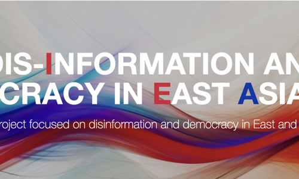

Presented with K. Asatani, M. Yoshida and Y. Kasuya as a panel talk at the IPSA World Congress 2025 in Seoul (13 July 2025), and again at the JSQPS 2026 Winter Meeting (Waseda University, January 2026).
